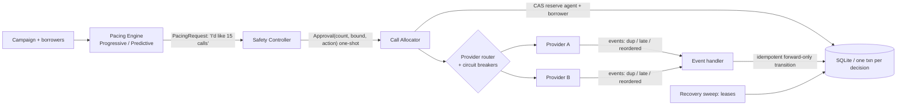
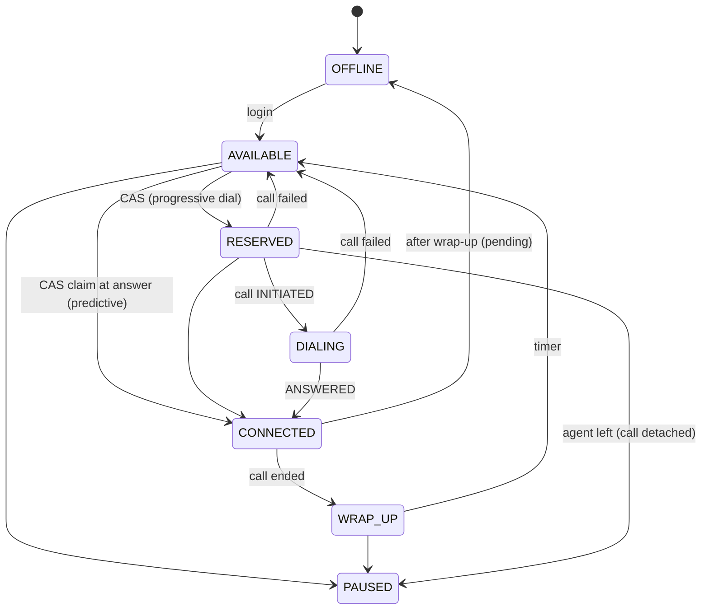
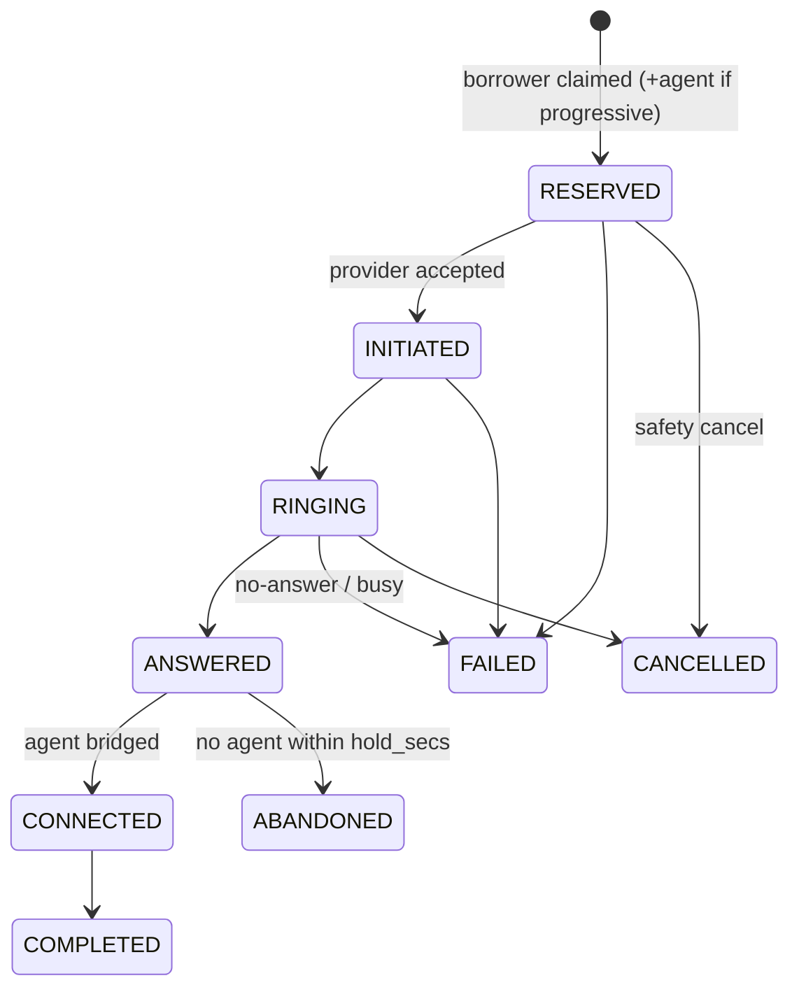

# Architecture and decisions

## 1. Flow

**The boundary.** `PacingRequest` is a plain value. Pacing code has no reference to the allocator, providers or store writes. `SafetyController.review()` is the only producer of `Approval`; `CallAllocator.execute()` calls `safety.consume()` which rejects any approval not issued by that controller instance or already used (tests: forged and replayed approvals raise `SafetyViolation`). There is no flag, config or method that disables safety.

## 2. State machines

`QUEUED` exists in the enum for a queue-first design but this prototype creates calls directly at `RESERVED`. `ABANDONED` is deliberately separate from `FAILED`: it is the compliance-relevant outcome (a human answered, nobody was there).

## 3. Concurrency answers

**Two workers see the same AVAILABLE agent.** `store._cas_agent` is `UPDATE agents SET state='RESERVED' ... WHERE id=? AND state='AVAILABLE'`; only one UPDATE can match, the loser sees `rowcount=0` and skips. Pick+claim+insert-call run in one `BEGIN IMMEDIATE` transaction, so a crash rolls back everything. Borrowers use the same pattern (`status='READY'` -> `CLAIMED`). Test: 8 threads on separate connections, 50 agents -> exactly 50 distinct reservations; load test repeats it at 500 agents.
On Postgres the same statement is correct under row locks; `FOR UPDATE SKIP LOCKED` lets many workers claim disjoint rows without queueing.

**DB says AVAILABLE, cache says RESERVED.** The DB wins, always: there is no cache in the decision path. Counts used by pacing are re-read each tick; a stale read can only cause a *proposal* that the CAS then refuses.

**Duplicates / out-of-order.** One rule: a transition applies only if it moves strictly forward in the lifecycle and the call isn't terminal (`CALL_RANK`). Plus `provider_events(provider,event_id)` dedupe inserted in the *same transaction* as the transition. `ANSWERED x3, COMPLETED` = one ANSWERED transition. `COMPLETED, ANSWERED, RINGING` = COMPLETED, later two counted as `stale_event`. Cost of this rule, stated honestly: if COMPLETED overtakes ANSWERED the agent is never bridged to a conversation that already ended; the call is recorded COMPLETED without `connected_at`.

**Worker crash after ANSWERED.** Nothing is held in memory: the event, call transition and agent bridge commit atomically. A new worker sees `CONNECTED`; the later COMPLETED applies normally.

**Worker crash mid-dial.** Reserved rows carry leases. `recovery.sweep` (run by any worker) asks the providers `get_status(call_id)`: known -> *adopt* (walk the call forward, never re-dial); unknown -> `FAILED(worker_crash)`, agent and borrower released, attempt not consumed. Provider `place_call` is idempotent on our `call_id`. Ambiguous timeouts are never retried on another provider (double-dial risk); they get a short lease and are resolved by the same probe.

## 4. Predictive pacing: "why 17 calls?"

Every decision is stored in `decisions` with its inputs and a sentence, e.g.
*"10 agents can take a call (7 free + 3 leaving wrap-up soon); assuming p<=0.48, keeping 15 calls in flight holds P(answers>agents)<=5%; 15 already in flight -> start 0 more"*.

- Capacity `K` = AVAILABLE agents + WRAP_UP agents finishing within the observed time-to-answer.
- `p` = **max(Wilson upper bound over short window, over long window)**: a rise in answer rate is detected fast; a drop is trusted slowly, so errors go toward fewer calls.
- Target in flight `N` = largest N with `P(Binomial(N,p) > K) <= 5%` (binary search; exact for K<=200, normal approximation above).
- Fewer than 30 samples: `p=1` -> behaves exactly like progressive (cold start).
- Predictive calls are *unbound* (no agent reserved); on answer an agent is claimed by CAS. If none, the call is **held** up to `hold_secs` (2s) then `ABANDONED`.

**Safety Controller (independent of the above):**
1. campaign inactive / all provider breakers OPEN -> **REJECT**; half-open -> single probe call.
2. Rolling abandon rate (last 100 answers): >=2% -> halve overdial (**REDUCE**); >=3% -> **FALLBACK_PROGRESSIVE** (agent reserved at dial, in-flight never exceeds free agents) until <=1.5% and 30s cooldown. State is in the DB so all workers agree.
3. Hard caps: overdial ratio 4x capacity, per-tick cap, ready-borrower count.
4. **Reconcile every tick**: using its own answer-rate bound, cancels pre-answer calls until overflow risk <=10% again. This is what reacts to agents vanishing (demo 3: 66 -> 26 in flight within one tick) and to answer-rate spikes.

"70% -> 10% answer rate": fewer answers cannot create abandons; pacing keeps the conservative long-window `p`, then slowly dials more. "10% -> 70%": the short window lifts `p` after ~30 samples, reconcile cancels excess, abandon governor is the backstop.

## 5. Failure cases (run `python -m smartdialer.scenarios`)

| Case | Behaviour |
|---|---|
| Worker crash | Leases + provider probe: adopt placed calls, fail unplaced, free agent/borrower. Demo 1 |
| Provider outage | Breaker opens after >=50% failures in 20 calls; new dialing REJECTed; existing calls keep receiving events; borrowers requeued with short backoff and **no attempt consumed**; half-open probe resumes. Failover A->B only on *definite* rejects. Demo 2 |
| 40/100 agents vanish | Next tick: capacity recomputed, excess unbound calls cancelled (least progressed first). Agents in RESERVED/DIALING are detached; their call becomes unbound/held. Demo 3 |
| Duplicates / out-of-order | Section 3. Demos 4+5, tests |

## 6. Technology choices (what / why / what it makes harder)

- **SQLite (WAL) + stdlib.** Why: transactions + CAS give all the correctness needed with zero ops; easy for a reviewer to run. Solves: atomic reserve, idempotency, crash safety. Harder: one writer at a time (see scale), no cross-host access.
- **No Kafka/Redis/microservices.** Workers are identical, stateless loops over a shared DB; there is nothing a queue would add that leases + CAS don't already do. A queue becomes useful for provider webhook buffering at high rate.
- **Polling tick (1s), not event-driven.** Simple and bounded reaction time; costs up to 1s latency before an agent freed by wrap-up is re-dialed.
- **Unbound predictive calls + hold window**, instead of reserving agents for overflow: reserving would tie up the agents the answered calls need.

## 7. Scale: what breaks first

Measured (`loadtest`): tick 0.5 ms @100 agents, 8 ms @1k, **130 ms @10k**; event ingestion ~20-45k/s single-threaded; reservation contention 2.5k/s with 8 threads.

1. **Single-writer DB and per-tick full scans/aggregates** (`snapshot`, `recent_stats` GROUP BY, and one `INSERT` per call in one txn). At 10k agents with ~100+ calls/s of churn the write lock is the bottleneck, not CPU. Fix: Postgres with `FOR UPDATE SKIP LOCKED` claims; **shard campaigns/agent pools** so each shard has one pacing leader (pacing must see one consistent pool; reserving stays parallel); maintain counters (free agents, in-flight, windowed answer/abandon stats) incrementally instead of re-aggregating.
2. **Cross-worker pacing double-counting.** N workers each computing "start 15 more" from the same snapshot overshoot. Fix: one pacing leader per shard (lease), others only execute approved batches; or a per-campaign in-flight budget row decremented atomically (the cap is the safety invariant either way).
3. **Provider rate limits / CPS** and breaker state being per-process. Fix: shared breaker/CPS counters, provider-side token bucket.
4. **Event storms** (10k agents ~ thousands of events/s). Fix: ingest webhooks to a durable queue, batch transitions per call id.
At 100k agents the shard count, not the algorithm, is the answer.

## 8. Final question: utilization of predictive, determinism of progressive

Treat safety as an invariant enforced by a layer the optimizer cannot touch, and let the optimizer only choose *how much slack to spend*. Concretely: (1) an unbypassable gate (one-shot approvals) between pacing and dialing; (2) a statistical overdial budget with conservative, asymmetric estimates; (3) a hard fallback that is purely progressive (in-flight <= free agents, agent reserved at dial), entered automatically on measured abandon rate, so the worst case degrades to deterministic behaviour rather than to violations; (4) every overdialed call stays *cancellable until answered*, so reaction to capacity loss is one tick; (5) the unavoidable residue (a held answered call) is bounded in time, recorded as ABANDONED and rate-limited. Simulations: utilization 52->75% (20% answer rate), 66->77%, 86->91%, with abandon rate <=0.2%.

## 9. Least confident / next week

- Measured abandon is far below the 3% limit: `epsilon=5%` plus Wilson bounds is conservative (idle 12-19%). A calibration sweep on real data would recover utilization.
- Breaker, pacing leader and rate limits are per-process; sharing them is not built.
- `agents_leave` for a CONNECTED agent sets a pending state; a hard agent disconnect mid-call is not modelled.
- Compliance window is "last 100 answers"; real rules (e.g. per-campaign per-30-days) need a durable ledger.
- Real provider integration (Plivo) not done; the `Provider` interface is the seam.
